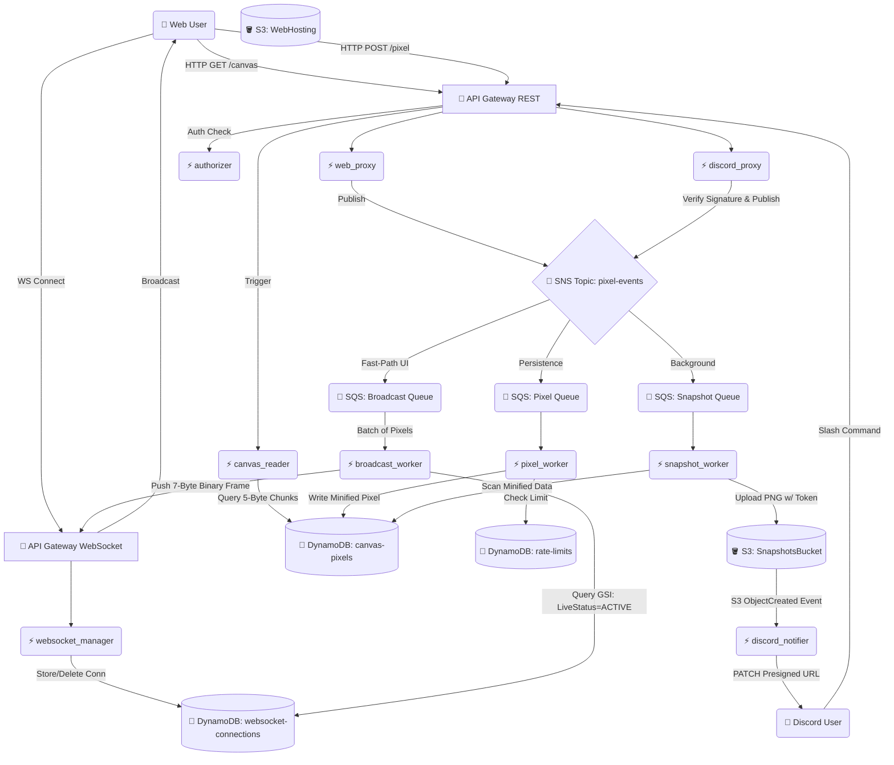

# Technical Architecture Documentation: Serverless Pixel Canvas

## 1. System Overview

This project is a **fully serverless**, **event-driven** collaborative pixel drawing platform (inspired by r/place) accessible via a Web Application and Discord Bot. The system is built exclusively on AWS managed services, utilizing Python for all compute logic. The architecture emphasizes the **Single Responsibility Principle (SRP)**, high scalability, and near real-time reactive updates without frontend polling.

### Architectural Diagram

---

## 2. Infrastructure Components

### 2.1 Frontend Hosting

- **Storage:** Amazon S3 bucket configured for static website hosting.
- **Delivery:** Amazon CloudFront (CDN) to serve the static assets securely via HTTPS and cache content globally for low latency.

### 2.2 API Gateways

All public traffic routes through **Amazon API Gateway**.

- **REST API:** Handles synchronous commands like authentication, drawing pixels, and Discord interaction webhooks.
- **WebSocket API:** Maintains persistent, stateful connections with web clients to push real-time canvas updates.

### 2.3 Compute (AWS Lambda - Python)

Functions are written in Python and follow strict SRP. They assume IAM execution roles granting least-privilege access to necessary resources.

### 2.4 Event Messaging (The Fan-Out Pattern)

- **Amazon SNS** (Topic: `pixel-events`): Acts as the central pub/sub router. Proxies publish events here.
- **Amazon SQS** (Queues): Subscribed to the SNS topic to buffer events, handle rate spikes, and trigger worker functions asynchronously. Features **Dead Letter Queues (DLQs)** for error handling.

### 2.5 Storage & Databases

- **Amazon DynamoDB:** A serverless NoSQL database used for state management.
- **Amazon S3** (Snapshots): A separate bucket stores generated PNG snapshots of the canvas.

---

## 3. Data Model (DynamoDB)

To support an "infinite" canvas efficiently, the canvas is divided into manageable chunks.

### Table: `canvas-pixels` (Stream Enabled)

| Key Type | Key Format | Example |
|----------|------------|---------|
| Partition Key (PK) | `CHUNK#<cx>#<cy>` | Coordinates of a 100×100 grid |
| Sort Key (SK) | `PIXEL#<x>#<y>` | — |
| **Attributes** | `color`, `author_id`, `timestamp` | — |

### Table: `websocket-connections`

| Key Type | Key Format |
|----------|------------|
| Partition Key (PK) | `CONNECTION#<connection_id>` |
| **Attributes** | `user_id` |

### Table: `rate-limits`

| Key Type | Key Format |
|----------|------------|
| Partition Key (PK) | `RATELIMIT#<user_id>` |
| Sort Key (SK) | `WINDOW#<minute>` |
| **Attributes** | `count`, `TTL` (auto-expires data) |

---

## 4. Core Workflows

### 4.1 Draw Pixel Flow (Asynchronous Fan-Out)

1. **Request:** User submits a pixel via Discord command or Web App (HTTP POST).
2. **Proxy:** `discord_proxy` or `web_proxy` validates the payload/signature, assigns tracing IDs, immediately responds with `202 Accepted` (or deferred state for Discord), and publishes a `draw_pixel` event to SNS.
3. **Queue:** SQS buffers the SNS event and triggers the `pixel_worker` in batches.
4. **Process:** The worker checks rate limits via an atomic counter in DynamoDB `rate-limits`. If valid, it writes the pixel to the `canvas-pixels` table calculating the correct chunk ID.

### 4.2 Real-Time Broadcast Flow (Reactive WebSockets)

This flow completely replaces client-side polling, reducing bandwidth and load.

1. **Trigger:** Writing a pixel to DynamoDB emits an event via **DynamoDB Streams**.
2. **Broadcast:** The `broadcast_worker` is invoked by the stream.
3. **Push:** The function retrieves active connection IDs from `websocket-connections`, concurrently pushes the new pixel data to connected clients via API Gateway Management API, and cleans up stale connections.

### 4.3 Snapshot Flow (Event-Driven)

1. **Trigger:** Admin issues `/snapshot` in Discord. `discord_proxy` pushes a `snapshot` action to SNS, which routes to the Snapshot SQS Queue.
2. **Generate:** `snapshot_worker` is triggered by SQS, reads the canvas state from DynamoDB, generates a PNG using Python's Pillow, and uploads it to an S3 bucket with the Discord interaction token saved in the S3 object metadata.
3. **Notify:** S3 emits an `ObjectCreated` event. The `discord_notifier` is triggered, reads the Discord token from metadata, and patches the deferred Discord message with the public S3 image URL.

---

## 5. Security & Deployment

- **Secrets Management:** Discord tokens, OAuth secrets, and API keys are stored in **AWS Secrets Manager** and accessed by Lambdas at runtime.
- **Authentication:** Web application endpoints are protected by an `auth-fn` (handling Discord OAuth2) and API Gateway Authorizers.
- **Infrastructure as Code (IaC):** The entire stack is defined and deployed using **AWS Serverless Application Model (SAM)** (`template.yaml`), allowing reproducible deployments via `sam build` and `sam deploy`.
